<div align="center">

# Google Cloud Platform (GCP) Automation & Lab Solutions

[](https://cloud.google.com/)
[](https://www.gnu.org/software/bash/)
[](https://kubernetes.io/)
[](https://cloud.google.com/bigquery)
[](https://www.terraform.io/)
[](LICENSE)

**A curated repository of 100+ production-ready Bash automation scripts and architectural solutions for Google Cloud Skills Boost labs, challenge assessments, and cloud infrastructure operations.**

[Service Catalog](#cloud-services--domain-catalog) • [Execution Workflow](#execution-workflow) • [Prerequisites](#prerequisites--usage) • [Disclaimer](#educational-disclaimer)

</div>

---

## 1. Overview

This repository provides automated Bash provisioning scripts and infrastructure-as-code recipes covering the full spectrum of **Google Cloud Platform (GCP)** services. Designed for Google Cloud Arcade participants, DevOps engineers, and cloud architects, these scripts demonstrate automated resource provisioning, IAM policy configuration, network topologies, BigQuery pipelines, and containerized deployments.

---

## 2. Cloud Services & Domain Catalog

```mermaid
flowchart TD
    GCP[Google Cloud Platform Ecosystem]
    
    GCP --> Compute[Compute & Containers]
    GCP --> Network[Networking & Security]
    GCP --> Data[Data & Streaming Pipelines]
    GCP --> AI[AI & Machine Learning]
    GCP --> DevOps[IaC & DevOps Monitoring]

    Compute --> C1[Compute Engine GCE]
    Compute --> C2[Kubernetes Engine GKE]
    Compute --> C3[Cloud Run Serverless]

    Network --> N1[VPC Peering & Flow Logs]
    Network --> N2[Cloud HA-VPN & Load Balancers]
    Network --> N3[Identity-Aware Proxy IAP]

    Data --> D1[BigQuery & BigLake Analytics]
    Data --> D2[Pub/Sub Event Streaming]
    Data --> D3[Cloud Dataflow ETL Jobs]

    AI --> A1[Vertex AI Studio]
    AI --> A2[Document AI & Speech-to-Text]
    AI --> A3[BigQuery ML Predictive Models]

    DevOps --> O1[Terraform IaC Deployments]
    DevOps --> O2[Cloud Monitoring & Logging]
    DevOps --> O3[Jenkins on Kubernetes]
```



### Domain Breakdown

| Domain | Key GCP Technologies | Featured Automation Scenarios |
| :--- | :--- | :--- |
| **Compute & Containers** | Compute Engine (GCE), Kubernetes Engine (GKE), Cloud Run | Multi-zone VM provisioning, MongoDB StatefulSets on GKE, rolling updates, Windows container hosting. |
| **Networking & Security** | VPC, Cloud HA-VPN, Cloud Load Balancing, BeyondCorp, IAP | VPC Network Peering, VPC Flow Log analysis, HTTP(S) Load Balancer configuration, Zero-Trust IAP tunneling. |
| **Data & Storage** | BigQuery, Cloud Storage (`gsutil`), Cloud Pub/Sub, Dataflow | Streaming analytics ingestion into BigQuery, Cloud Storage bucket lifecycle rules, FHIR to Dataflow pipelines. |
| **AI & Machine Learning** | Vertex AI, Document AI, Speech API, Translation API, BigQuery ML | Predictive ML regression models in SQL, speech audio transcription, visual sentiment analysis. |
| **DevOps & Governance** | Terraform, Cloud Monitoring, Logging, Service Accounts, CFT | Terraform multi-tier state setup, custom alerting policies, IAM role binding least-privilege automation. |

---

## 3. Prerequisites & Usage

### Prerequisites
- Active Google Cloud Platform account / project with billing enabled.
- [Google Cloud SDK (`gcloud` CLI)](https://cloud.google.com/sdk/docs/install) initialized, or **Google Cloud Shell**.

### Quick Execution Pattern
```bash
# 1. Clone repository in Google Cloud Shell
git clone https://github.com/AnniiGCP/Google-Cloud-Arcade.git
cd Google-Cloud-Arcade

# 2. Grant execution permissions
chmod +x "script-name.sh"

# 3. Export environment parameters (if required)
export ZONE="us-central1-a"
export REGION="us-central1"

# 4. Execute automation script
./"script-name.sh"
```

---

## 4. Educational Disclaimer

> [!NOTE]
> These automation scripts are designed for educational exploration, Google Cloud Skills Boost lab verification, and rapid cloud prototyping. When deploying to production enterprise environments, ensure all IAM roles adhere to the principle of least privilege, enable Cloud Audit Logging, and validate security scorecards using Cloud Security Command Center.
